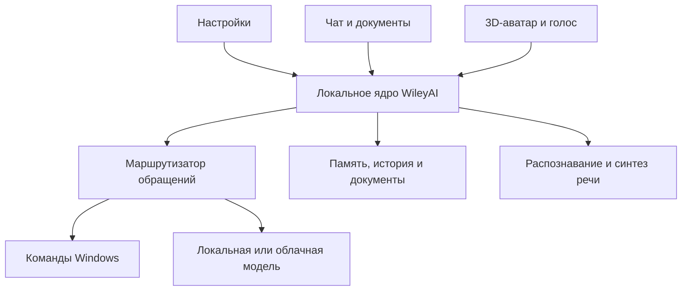

# WileyAI: исследование и план персонального ассистента

Дата исследования: 15 октября 2026 года.

Это предложение архитектуры и план проверки гипотез. Репозитории изучены по актуальным README, документации, структуре и отдельным файлам исходников. Их приложения и модели на этом ПК не устанавливались и не тестировались. Указанные ниже сроки и бюджеты ресурсов — предварительные инженерные оценки.

## 1. Что должен получить пользователь

Русскоязычный персональный ассистент с характером, памятью, чатом, загрузкой документов, голосовым общением и аватаром на рабочем столе. Основная работа происходит локально. Облачные модели подключаются через сменные адаптеры.

Уточнённый объём управления ПК: открывать папки, файлы, приложения и сайты, распознавать речь и понимать свободно сформулированные команды. Поэтому универсальная автоматизация графического интерфейса не является обязательной частью первой версии.

Первая версия должна сбалансировать общение, память и полезные действия. Дополнительный приоритет — эффективное использование ресурсов ноутбука.

Пользователь выбрал собственное компактное ядро, готовые компоненты моделей и речи, VRM-аватар и прямые команды Windows. AIRI остаётся альтернативным прототипом и источником практических решений для персонажа. Обязательное дополнение: пользователь может самостоятельно выбирать, скачивать и импортировать поддерживаемые модели общения, распознавания речи и озвучки, подключать внешние серверы и сохранять сочетания компонентов в профили.

Предварительное допущение до выбора режима облака: локальная модель используется по умолчанию, переход в облако выбирает пользователь. Автоматическое переключение можно включить отдельной настройкой.

## 2. Что найдено на GitHub

Наличие функции в README означает заявление проекта, а не результат нашей проверки. Оценка пригодности ниже — вывод для конкретных требований WileyAI.

| Проект | Подтверждённое направление | Значение для WileyAI |
| --- | --- | --- |
| [AIRI](https://github.com/moeru-ai/airi) | Персонаж, голос, VRM и Live2D, настольный клиент, разные провайдеры. Память Alaya отмечена как WIP. Основная лицензия MIT. | Главный кандидат для прототипа живого аватара. Проверить задержки, русскую речь, расход памяти и расширяемость. |
| [Open-LLM-VTuber](https://github.com/Open-LLM-VTuber/Open-LLM-VTuber) | Локальное голосовое общение, перебивание, Live2D и прозрачный desktop pet. README сообщает о временном удалении долговременной памяти и планировании переписывания v2. | Быстрый способ попробовать голосового персонажа. Для основного продукта потребуется собственная память; 3D не является его основным форматом. |
| [Amica](https://github.com/semperai/amica) | VRM-персонажи, речь и эмоциональные выражения; Three.js, three-vrm и настольная оболочка Tauri. Основной код MIT, ассеты лицензируются отдельно. | Полезный пример сравнительно прямой реализации 3D-общения. Управление файлами и полноценную память нужно проектировать отдельно. |
| [Leon](https://github.com/leon-ai/leon) | Инструменты, локальные и удалённые модели, память. README обозначает ветку develop как 2.0 Developer Preview и предупреждает об устаревших старых руководствах. MIT. | Ближе к функциональному ассистенту; оценить как альтернативное ядро, если задачи существенно расширятся. |
| [OpenClaw](https://github.com/openclaw/openclaw) | Постоянно работающий ассистент, каналы общения, сменные модели, локальное состояние и память. MIT. | Полезен для фоновой активности и мессенджеров. Для первых четырёх типов команд его инфраструктура может оказаться избыточной. |
| [Interpreter Workstation](https://github.com/openinterpreter/interpreter-workstation) | Рабочее приложение с агентным ядром Open Interpreter, локальными и облачными моделями, доступом к файлам и приложениям. | Интересен при переходе к сложным рабочим задачам. Совместимость конкретной сборки с Windows надо проверить отдельно. |
| [SillyTavern](https://github.com/SillyTavern/SillyTavern) | Настройка персонажей и контекста, множество провайдеров, TTS и расширения. AGPL-3.0. | Хороший ориентир по управлению личностью. Использовать как отдельный стенд для сравнения поведения. |
| [Letta](https://github.com/letta-ai/letta) / [актуальное ядро letta-code](https://github.com/letta-ai/letta-code) | Агенты с сохраняемой идентичностью и памятью. README основного репозитория направляет за текущим кодом в letta-code; старый API-сервер находится в archive. | Изучить управление памятью. Для небольшой первой версии собственное простое хранилище легче контролировать. |
| [Microsoft UFO²](https://github.com/microsoft/UFO/blob/main/ufo/README.md) | Автоматизация Windows через UI Automation, Win32, COM и зрение. | Отложить до появления задач с действиями внутри приложений. Открытию папок и сайтов такая система не требуется. |

В дополнение рассмотрены [Windows-MCP](https://github.com/CursorTouch/Windows-MCP) и [Playwright MCP](https://github.com/microsoft/playwright-mcp): это кандидаты на инструменты для будущего расширения, а не обязательные зависимости MVP.

В структуре AIRI проверены [манифест настольного клиента](https://github.com/moeru-ai/airi/blob/main/apps/stage-tamagotchi/package.json) и [манифест computer-use-mcp](https://github.com/moeru-ai/airi/blob/main/services/computer-use-mcp/package.json). Само присутствие модуля не подтверждает надёжное управление всеми приложениями.

У Leon отдельно прочитано [описание архитектуры](https://github.com/leon-ai/leon/blob/develop/core/context/ARCHITECTURE.md): полезны единый контракт клиентов, загрузка инструментов по необходимости и разделение долговременной памяти, текущего контекста и истории.

## 3. Три варианта реализации

### Вариант A: доработать AIRI

Выбирать, если важнее быстрее получить ощущение живого персонажа. Проверить готовый настольный клиент, подключить локальную модель и русский голос, затем добавить узкий модуль команд и память.

Плюс: меньше работы над аватаром и голосовым интерфейсом. Минус: собственные настройки, документы и хранение данных придётся согласовать с чужой архитектурой и её обновлениями.

### Вариант B: собственное приложение из готовых компонентов — выбран пользователем

Своими сделать интерфейсы, память, личность и исполнение команд. Готовыми взять запуск моделей, распознавание речи, синтез и отображение VRM.

Плюс: система соответствует уточнённому объёму задач, проще оптимизировать общую память и поведение. Минус: голосовое взаимодействие и анимацию потребуется довести самостоятельно.

### Вариант C: функциональное ядро Leon/OpenClaw с отдельным аватаром

Выбирать, если в ближайшее время понадобятся мессенджеры, сложные фоновые задания, много интеграций и цепочки инструментов. Потребуется синхронизировать события, историю и личность между ядром и визуальным клиентом.

Для текущего объёма команд этот путь не даёт очевидного выигрыша в простоте или ресурсоёмкости.

## 4. Устройство рекомендуемого приложения

Один установщик, общее локальное ядро, три независимо открываемых интерфейса:

1. **WileyAI Settings** — менеджер моделей с каталогом, скачиванием и импортом, подключения, голос, личность, память, каталоги, команды, горячие клавиши, профили ресурсов и резервные копии.
2. **WileyAI Chat** — разговоры, загрузка файлов, результаты работы, источники ответов по документам и история действий.
3. **WileyAI Avatar** — прозрачное окно с 3D-персонажем, микрофоном, короткими репликами и быстрым доступом к чату и настройкам.

Общий сеанс, одна личность и одна память. Закрытие окна чата не должно останавливать голос и аватар. Окно настроек не обязано постоянно работать.

Предварительный стек:

- **Electron + TypeScript + React** для первой оболочки: чат, настройки и прозрачное окно персонажа в общем приложении. **Tauri 2** — альтернативный вариант после проверки прозрачности, аудио и потребления RAM на этом ПК. Заменять оболочку стоит по измерениям.
- **Three.js + [three-vrm](https://github.com/pixiv/three-vrm)** для VRM. Если позже потребуется сложная пространственная сцена, физика и взаимодействие с окнами, можно вынести персонажа в Godot; на старте дополнительный движок усложняет продукт.
- **Python + локальный API** для памяти, документов и речевых компонентов. Длительные задачи — в отдельных управляемых процессах; простой маршрутизатор команд не должен ждать OCR или индексацию.
- **SQLite** для настроек, истории, фактов и состояния заданий. Начать с полнотекстового поиска; векторный индекс добавить там, где он улучшает поиск по смыслу. Отдельный сервер БД и Docker в первой версии не требуются.
- События между интерфейсами и ядром: начало записи, распознанный текст, фрагмент ответа, начало/окончание аудио, выполнение команды, завершение задачи, ошибка.

Ядро запускается в пользовательском сеансе Windows с иконкой в трее. Приложение владеет запуском и остановкой своих дочерних процессов. Речевые библиотеки можно позднее упаковать в собственный runtime, чтобы пользователю не приходилось настраивать Python вручную.

### Менеджер моделей и компонентов — обязательная часть продукта

Пользователь не привязан к одной нейросети или голосу. Меняются независимо:

| Компонент | Что выбирает пользователь | Что сохраняется при замене |
| --- | --- | --- |
| Общение и понимание свободных команд — LLM | Локальная модель, подключённый локальный сервер или облачный провайдер | Личность, история, память, команды и настройки владельца |
| Распознавание речи — STT | Движок и поддерживаемая им модель, язык и устройство вычислений | Словарь имён и псевдонимов, микрофон и горячие клавиши |
| Озвучка — TTS | Движок, модель, голос и доступные параметры речи | Личность и текстовая память; звучание зависит от выбранного компонента |
| Поиск по памяти и документам — embeddings | Совместимая модель представления текста | Исходные документы и факты; производный векторный индекс перестраивается |
| Внешность | Локальный файл VRM и настройки отображения | Переписка, память и настройки моделей |

Модель, движок её запуска и конкретный голос — разные сущности. Один движок может поддерживать несколько моделей, одна TTS-модель — несколько голосов. Пользователь видит простые названия; технические параметры доступны в расширенных настройках. Импорт произвольного файла не гарантирует его работу: нужны поддерживаемые архитектура, формат, токенизатор и сопутствующие файлы.

Три основных способа добавления модели:

1. **Каталог:** выбрать модель из поддерживаемого списка, увидеть требования и нажать «Скачать». Для озвучки доступна короткая проба голоса после установки.
2. **Импорт:** указать файл или каталог на диске. Модель проверяется на совместимость; по умолчанию можно подключить существующий путь без создания второй копии, с отдельной возможностью копирования в библиотеку WileyAI.
3. **Подключение сервера:** задать адрес и необходимые реквизиты, выполнить проверку соединения, выбрать модель из списка сервера либо указать её идентификатор вручную. Локальные файлы в этом случае не скачиваются WileyAI.

Каталог расширяется через версионируемые описания моделей и адаптеры. Предусмотреть добавление источника по идентификатору репозитория или ссылке с выбором конкретных файлов. Неизвестная архитектура отображается как неподдерживаемая, с объяснением необходимого адаптера; приложение не обещает автоматически запускать любую найденную модель.

Карточка компонента содержит: назначение, источник, версию, размер загрузки, необходимые сопутствующие файлы, поддерживаемые языки, движок, форматы, лицензию источника, возможности и ориентировочные требования RAM/VRAM. Оценка ресурсов явно отличается от измеренных значений. Для LLM отдельно отмечаются изображения, вызов инструментов и потоковый ответ; для TTS — доступные голоса, потоковая озвучка и параметры, реально поддерживаемые адаптером.

Скачивание выполняется фоновым менеджером: очередь, прогресс, скорость, оценка оставшегося времени при наличии данных, пауза, отмена и продолжение там, где источник поддерживает докачку. Перед загрузкой проверяется место на диске. При наличии опубликованной контрольной суммы проверяется целостность; состояние частичной загрузки не считается установленной моделью. Источники, требующие входа или принятия условий, показывают понятный шаг подключения. Ключи не включаются в экспорт профилей.

Папка библиотеки выбирается пользователем, например `D:\WileyAI\models`; внешние импортированные пути учитываются отдельно. Поддерживаются несколько установленных моделей и удаление неиспользуемых. Удаление записи внешнего импорта по умолчанию отключает её в WileyAI, сохраняя исходные файлы. Файлы, общие для нескольких установок, учитываются как зависимости.

Состояния разделены: «скачивается», «установлена», «проверена», «загружена в память», «активна», «ошибка». Скачивание не вызывает автоматическую загрузку в VRAM. Можно скачать большую модель заранее, продолжая пользоваться небольшой.

Контракты адаптеров:

- **LLM:** список моделей, проверка возможностей, загрузка/выгрузка для управляемых локальных движков, потоковый ответ и отмена.
- **STT:** список моделей, подготовка, распознавание аудио и отмена; потоковое распознавание — только при поддержке движком.
- **TTS:** список моделей и голосов, подготовка, синтез и остановка; поток аудио и временные метки фонем — необязательные возможности.
- **Менеджер ресурсов:** доступное место, состояние процессов и очередность загрузки моделей. Для внешнего сервера управление его памятью доступно только при наличии соответствующего API и разрешения.

Смена компонента проходит на границе операции либо с явной отменой текущей. Новый компонент проверяется коротким запросом; настройка становится активной после успешной проверки. При недостатке памяти предыдущая локальная модель сначала выгружается; при неудаче выполняется попытка загрузить прежнюю. История и задания остаются в ядре. Личность переносится, но манера ответов другой LLM может отличаться.

Смена embeddings запускает перестроение отдельного индекса с версией модели; до завершения используется прежний индекс либо текстовый поиск. Нельзя смешивать в одном поисковом пространстве векторы разных моделей. Личность и подтверждённые факты при этом не пересоздаются.

Профили связывают выбранные LLM, STT, TTS, голос, контекст и ресурсные настройки: «экономичный», «сбалансированный», «максимальное качество» и пользовательские. Установка компонентов и выбор активного профиля независимы. Совместимость компонентов проверяется не только по отдельности, но и по ожидаемой суммарной нагрузке.

Первая версия менеджера ограничивается небольшим проверенным каталогом, одним локальным LLM-движком, одним STT-движком и одним TTS-движком со сменными моделями или голосами в пределах их возможностей. Подключение внешнего API и импорт поддерживаемых пакетов входят в базовый сценарий. Другие движки добавляются через те же контракты без изменения личности, памяти и интерфейса команд.

## 5. Команды ПК: короткий и предсказуемый путь

Поток: речь → текст → определение намерения и объекта → разрешение пути/программы/URL → проверка → вызов инструмента → проверка результата запуска → короткий ответ.

Минимальные инструменты:

| Намерение | Пример | Реализация |
| --- | --- | --- |
| Открыть папку | «Покажи загрузки», «Открой папку с проектами» | Известные папки Windows и пользовательские псевдонимы |
| Открыть приложение | «Запусти телеграм», «Открой редактор» | Индекс ярлыков, установленных приложений и явных назначений пользователя |
| Открыть сайт | «Зайди на ютуб», «Открой сайт университета» | Каталог сайтов; проверенный URL передаётся браузеру |
| Открыть файл | «Открой вчерашний отчёт» | Поиск в выбранных каталогах; при нескольких подходящих файлах — выбор кандидата |
| Выполнить набор запусков | «Открой рабочее окружение» | Сохранённый сценарий: папка проекта + редактор + нужные сайты |

Привычные команды и псевдонимы обрабатываются без LLM. Свободные и неоднозначные формулировки разбирает модель в строго заданную структуру. Нельзя передавать текст ответа модели напрямую в PowerShell. Файлы открываются стандартным приложением, программы — по разрешённой записи каталога, сайты — через обработчик HTTP/HTTPS.

Нужно различать разговор, команду и цитату: «Не открывай браузер», «Как открыть браузер?» и «Мне сказали “открой браузер”» не должны запускать приложение.

Команда «открой браузер» не требует перебора файлов. Поиск «вчерашнего отчёта» требует выбранных каталогов и разрешения неоднозначности. Открытие URL подтверждает передачу браузеру, но не гарантирует успешную загрузку сайта; в интерфейсе следует честно различать эти состояния.

## 6. Локальные модели и ограничения оборудования

Прочитаны характеристики текущего ПК: AMD Ryzen 9 7945HX, NVIDIA RTX 4060 Laptop, 8188 MiB видеопамяти по nvidia-smi; около 15 ГБ RAM, видимой Windows. Это не замер свободной памяти.

Начальный кандидат — **[Qwen3.5-4B](https://huggingface.co/Qwen/Qwen3.5-4B)** в 4-битном формате. [Ollama публикует вариант 4B](https://ollama.com/library/qwen3.5). Размер файла модели не равен расходу VRAM: отдельно нужны контекст, буферы и, при использовании изображений, визуальные компоненты.

Для требования уменьшить ограничения ответов есть **[Huihui-Qwen3.5-4B-abliterated](https://huggingface.co/huihui-ai/Huihui-Qwen3.5-4B-abliterated)**. Автор предоставляет вариант для Ollama и описывает его как uncensored. Это кандидат для сравнения, а не обещание отсутствия любых отказов. Отдельно проверяются русский язык, следование командам и стабильность формата инструментов.

Другой пример такого направления — [Dolphin3.0-Llama3.1-8B](https://huggingface.co/dphn/Dolphin3.0-Llama3.1-8B), но он не выбран исходным вариантом: на этом ПК меньшая модель оставляет больше ресурсов остальным компонентам. Качество конкретного варианта надо измерять.

В WileyAI можно не добавлять собственный тематический фильтр. Поведение локальной модели определяется её обучением и настройками; ограничения облачного сервиса остаются у провайдера.

Запуск моделей: сначала **[Ollama](https://github.com/ollama/ollama)** для удобного управления; **[llama.cpp](https://github.com/ggml-org/llama.cpp)** — альтернатива при необходимости более явного управления упаковкой и загрузкой. Не запускать оба сервера без задачи.

Профиль 8–9B рассматривать после измерений. Предварительно он оставляет меньше запаса для голоса, контекста и аватара. На старте ограничить контекст, например 8K токенов, и извлекать нужную память отдельно; затем подобрать лимит по замерам. Поддержка большого контекста в карточке модели не означает, что его следует полностью выделять на ноутбуке.

Если измерения покажут давление на RAM, рассмотреть расширение до 32 ГБ при совместимости ноутбука. Это не увеличит VRAM и само по себе не ускорит вычисления модели на GPU.

## 7. Русская речь

Начальный конвейер:

- Нажатие горячей клавиши или кнопки микрофона.
- **[Silero VAD](https://github.com/snakers4/silero-vad)** определяет участки речи, но не распознаёт слова.
- **[faster-whisper](https://github.com/SYSTRAN/faster-whisper)** с мультиязычной small-моделью и int8 на CPU — стартовая гипотеза; выбрать по тестам русской речи, шума и времени ожидания. Варианты larger/turbo на GPU сравнивать с учётом конкуренции с LLM.
- Синтез **[Silero TTS](https://github.com/snakers4/silero-models)** на CPU. Для русской речи доступны специальные модели; выбирать конкретную версию и её лицензию, поскольку лицензии семейств различаются.
- При необходимости более выразительного голоса сравнить **[Qwen3-TTS 0.6B](https://huggingface.co/Qwen/Qwen3-TTS-12Hz-0.6B-CustomVoice)**: русский указан в карточке модели. Задержка на этом ПК пока неизвестна.

[Vosk](https://github.com/alphacep/vosk-api) — альтернативный стенд для непрерывного распознавания коротких команд с ограниченным словарём. Выбирать его вместо Whisper стоит только если тесты подтвердят выигрыш при приемлемом качестве.

Следующий этап: активационная фраза, прерывание озвучки, подавление эха, устойчивость к собственной речи ассистента. Постоянно работающий тяжёлый распознаватель не является обязательным условием «живого» общения. Имена файлов, смешение русского с английским, числа и аббревиатуры проверяются отдельно.

## 8. Личность и память

Личность хранится независимо от поставщика LLM: имя, манера речи, юмор, инициативность, голос, привычки общения и принципы поведения. Это помогает сохранять узнаваемость при смене моделей, хотя абсолютной одинаковости добиться нельзя.

Уровни памяти:

1. **Текущий разговор** — последние реплики и краткое состояние диалога.
2. **Профиль владельца** — устойчивые предпочтения, имена, привычные пути, любимые приложения.
3. **Эпизоды** — значимые разговоры, решения, события и незавершённые вопросы.
4. **Задачи и проекты** — текущая цель, найденные файлы, принятые решения и следующий шаг.
5. **Навыки** — именованные сценарии и проверенные способы выполнения повторяемых задач.

Каждый долговременный факт имеет источник, время записи, статус актуальности и возможность исправления. Предположение ассистента не становится фактом о владельце без достаточных оснований. Конфликтующие сведения обновляются с историей, а не бесконтрольно накапливаются.

В настройках: просмотр памяти, «запомни», «забудь», исправление, экспорт, импорт, резервная копия. Удаление должно затрагивать факт, его поисковое представление и производные сводки; хранение исходной переписки управляется отдельно.

Эффект обучения сначала достигается памятью, обратной связью и сохранёнными сценариями. Веса модели не обновляются после каждой беседы. Дообучение LoRA — отдельный поздний эксперимент на отобранных примерах, с проверкой качества и возможностью возврата.

Настроение, мимика и инициативные реплики создают характер поведения; это не доказательство сознания. Инициативность регулируется: тихие часы, частота обращений, допустимые поводы. Для непрерывности личности важнее точная память и последовательные привычки, чем случайное изменение «настроения».

## 9. Документы и облачные подключения

Начать с TXT/MD, PDF с текстовым слоем и DOCX; затем добавить таблицы XLSX/CSV, создание документов и OCR сканов. Отдельно проверять чтение содержания и сохранение оформления при редактировании.

Документы разбиваются на фрагменты с привязкой к странице или разделу. Ответы по ним показывают источник. Индекс документов и личная память разделяются: утверждение из загруженной статьи не становится убеждением или предпочтением владельца.

Для поиска по смыслу сравнить [multilingual-e5-small](https://huggingface.co/intfloat/multilingual-e5-small) на CPU. [Docling](https://github.com/docling-project/docling) рассматривать для сложных документов и OCR; тяжёлый разбор запускается по необходимости.

Интерфейс моделей должен описывать возможности: текст, изображения, инструменты, потоковый ответ, контекст и особенности формата. OpenAI-совместимый endpoint покрывает часть серверов; для несовместимых протоколов нужны отдельные адаптеры. «Любая облачная модель» означает расширяемость через адаптер, а не гарантированную совместимость всех API без доработки.

Ключи хранятся в системном хранилище секретов, не в интерфейсе персонажа. Пользователь видит выбранного провайдера и может задать отдельные модели для общения и задач. Внешнему провайдеру передаются только необходимые фрагменты с учётом настроенного режима. Для полного офлайна локальными должны быть также речь, поиск по памяти и разбор документов; веб-поиск и открытие сайтов, естественно, требуют сети.

## 10. Оптимизация процессов и ресурсов

| Область | Решение | Что измерять |
| --- | --- | --- |
| Типовые команды | Каталог объектов и быстрый разбор без LLM | Задержку и долю правильных запусков |
| Модель | Одна активная основная модель; другие загружаются по необходимости | VRAM, RAM, холодный/тёплый запуск |
| Контекст | Краткое состояние + релевантная память вместо всей истории | Время первого токена и точность воспоминаний |
| Речь | VAD, CPU-компоненты, последовательность обработки | Время от окончания фразы до действия/ответа |
| Документы | Хеш содержимого, индексирование только изменений, фоновая очередь | Время поиска, нагрузку при индексации |
| Аватар | Одна лёгкая VRM-модель, ограничение FPS, пауза рендера при скрытии | GPU, VRAM, энергопотребление |
| Интерфейсы | Настройки и чат открываются по необходимости | Общую RAM всех процессов |
| Фон | События и редкие обслуживающие задания вместо частых запросов к LLM | Нагрузку и пробуждения в простое |

Профили:

- **Экономичный:** модель выгружается после простоя, голос по кнопке, аватар 15–30 FPS, фоновые задачи ограничены. Цена экономии — задержка первого ответа.
- **Сбалансированный:** основная 4B-модель остаётся загруженной во время общения, VAD и речь используют CPU там, где позволяют замеры; аватар около 30 FPS.
- **Максимальное качество:** более крупная модель и/или выразительный TTS, дополнительные компоненты загружаются с учётом свободных ресурсов. Облачное обращение подчиняется отдельной настройке.

Ограничение памяти настраивается по сумме потребления Windows, браузера, приложения и моделей. Переключение моделей не должно происходить на каждой короткой реплике. Извлечение новых фактов и обслуживание индекса выполнять после ответа или в простое, с небольшим бюджетом.

Для многосоставных команд независимые открытия можно объединять. Действия в графическом интерфейсе, если они появятся позже, требуют последовательного выполнения и учёта пользовательского ввода.

## 11. Доступ к ПК

Предусмотреть настраиваемые права и режим доверия владельца. Для первой версии достаточно доступа к пользовательским файлам, запуску программ и браузеру. Полные административные права не требуются для обычного открытия папок; операции с повышением прав добавляются отдельно при реальной задаче.

Нужны глобальная остановка, отключение микрофона, журнал действий и восстановление изменений там, где инструменты умеют менять файлы. Содержимое сайтов и документов рассматривается как данные и не выдаёт команды системе само по себе. Это повышает предсказуемость работы при широком доступе.

## 12. Порядок реализации

### Этап 0. Проверка ключевых компонентов

Ориентир: 3–5 рабочих дней после подготовки окружения.

- Сравнить обычную и abliterated 4B-модель на одинаковых русских диалогах и командах.
- Проверить STT, TTS и один VRM-аватар одновременно с LLM.
- Снять суммарные RAM/VRAM, задержки, загрузку CPU/GPU и поведение в простое.
- Подтвердить выбранную архитектуру собственного клиента; использовать AIRI как сравнительный прототип при необходимости.
- Проверить скачивание, импорт и переключение совместимых моделей; выбрать первый набор поддерживаемых адаптеров.

Результат: измерения и выбранная рабочая связка. Покупка оборудования до этих измерений не обязательна.

### Этап 1. Полезное ядро и интерфейсы

Ориентир: 2–3 недели.

Чат, настройки, локальный провайдер, один облачный адаптер, менеджер LLM с небольшим каталогом, скачиванием, импортом и переключением, единая история, базовый профиль личности, четыре типа открывающих команд, псевдонимы и горячая клавиша. Простая реакция аватара может появиться уже здесь.

### Этап 2. Память, файлы и голос

Ориентир: 2–3 недели.

Редактируемая долговременная память, поиск по истории, загрузка первых форматов документов, голос по кнопке, озвучка, выбор и загрузка поддерживаемых STT/TTS-компонентов, проба голоса и сохранённые наборы запусков.

### Этап 3. Цельное поведение персонажа

Ориентир: 2–3 недели.

Прозрачное окно, импорт VRM, движение губ, состояния «слушает/отвечает/выполняет», выражения, перетаскивание, режим пропуска кликов, несколько мониторов и восстановление после сна. Приоритет — согласованность речи, чата и действий.

### Этап 4. Удобство повседневного использования

Ориентир: 2–4 недели.

Установщик, запуск вместе с Windows, ресурсные профили, резервные копии, обработка ошибок устройств, активационная фраза и перебивание при достаточном качестве звука.

Оценки предполагают одного разработчика и использование готового аватара. Это диапазоны работ, не обещание календарной даты. Первая полезная версия может появиться за 2–4 недели; доведение всей перечисленной системы — порядка 2–4 месяцев, с пересмотром после этапа 0. Создание авторской 3D-модели и сложная автоматизация приложений оцениваются отдельно.

Сроки выше были предварительно оценены до детализации менеджера моделей. При ограниченном первом каталоге его базовые функции распределяются между этапами 1 и 2. Поддержка множества движков, произвольных удалённых источников и автоматической установки их зависимостей требует отдельной оценки после проверки адаптеров.

## 13. Как понять, что первая версия работает

- После перезапуска ассистент сохраняет утверждённое имя, характер и проверенные предпочтения.
- Понимает разные варианты четырёх типов команд, не выполняет отрицания и вопросы как приказ.
- При нескольких файлах предлагает кандидатов, не придумывает путь.
- Русские команды проверены и текстом, и через микрофон; ошибки распознавания видны и исправимы.
- Память можно исправить и удалить; старое значение не возвращается из производного индекса.
- Ответ по документу связан с реальным фрагментом источника.
- Чат, аватар и настройки используют одно состояние и согласованно показывают выполнение задачи.
- В локальном режиме ни один компонент незаметно не обращается за вычислениями к облачному API.
- Пользователь скачивает модель из каталога, импортирует поддерживаемый локальный пакет и подключает внешний сервер; ошибки совместимости объясняются до активации.
- После смены LLM или TTS сохраняются личность, переписка, подтверждённые воспоминания и команды.
- Прерванная загрузка не появляется как установленная; при поддержке источником докачки её можно продолжить. Недостаток места и ошибки целостности показываются явно.
- Несколько установленных моделей не загружаются в память одновременно без необходимости; скачивание не переключает активный профиль.
- Голос можно прослушать до выбора; отсутствие русского языка или нужной функции показывается в карточке компонента.
- Смена embeddings не смешивает векторы разных моделей и не удаляет исходную память.
- Замерены p50/p95 задержки команд и начала ответа, качество распознавания, RAM/VRAM под нагрузкой и расход ресурсов в простое. Числовые цели устанавливаются после первого измерения.

Выбранное решение: собственное компактное ядро WileyAI, готовые сменные компоненты моделей и речи, встроенный менеджер скачивания и импорта, VRM-аватар и прямые команды Windows. AIRI — основной альтернативный прототип и источник практических решений для персонажа. Расширять автоматизацию экрана по конкретным новым задачам.
