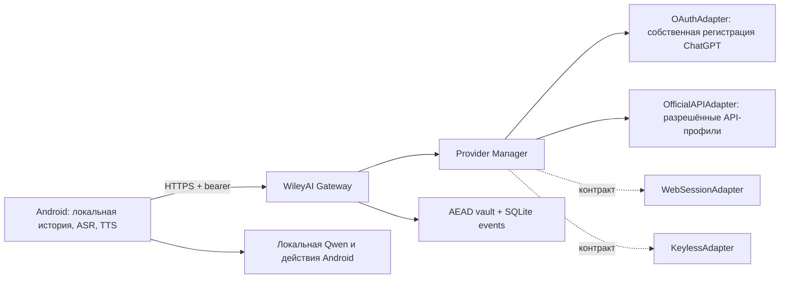

# Архитектура WileyAI Gateway v1

Статус: первая реализация, отдельная от настольного шлюза 48443. Провайдерская
совместимость ограничена документированными интерфейсами и реальными разрешениями
аккаунта. [Аудит](research/gateway-wileyai-audit.ru.md),
[сравнение 24 решений](research/gateway-comparison.ru.md).

## Контракт адаптера

`gateway/protocol.py`: статус, текущий каталог моделей, поток типизированных
событий, disconnect и close. OAuth может дополнительно предоставлять start/
complete авторизации. Четыре категории отдельны; отсутствие реализации не
маскируется универсальным browser proxy. Extension — доверенный серверный модуль,
добавленный владельцем и рассмотренный при выпуске. Удалённый Python/JS из
manifest/URL не исполняется. Автоустановка расширений и проверка их подписей —
будущий этап; сейчас действует встроенный allowlist.

`Model` содержит capabilities со статусами verified / advertised / experimental /
unknown / unavailable, источником и временем. ID из `/models` подтверждает
наличие записи в каталоге, а не vision или image generation. Нет fallback на
статические модели при сбое discovery. Каталог кэшируется на 5 минут с явным
обновлением. Подтверждение ответа аккаунтом фиксируется отдельно от списка моделей.

## Клиентский протокол

Префикс `/api/v1`; версия — `GET /info`. Токен Gateway не является платным ключом
нейросети. Владелец и client role проверяются на каждом запросе; owner никогда
не принимается из тела запроса. Все объекты изолированы по owner.

| Операция | Маршрут |
| --- | --- |
| Каталог разрешённых/недоступных сервисов | `GET /providers` |
| Аккаунты, создать, отключить | `GET/POST /connections`, `DELETE /connections/{id}` |
| Модели и capabilities | `GET /connections/{id}/models?refresh=true` |
| Начать/завершить собственный OAuth | `POST /connections/{id}/auth/start`, `/auth/complete` |
| Диалоги/история | `GET/POST /conversations`, `GET /conversations/{id}` |
| Ветка для изменения вопроса/повтора | `POST /conversations/{id}/fork` |
| Создать generation job | `POST /conversations/{id}/runs` |
| Состояние/частичный ответ | `GET /runs/{id}` |
| Продолжить чтение потока | `GET /runs/{id}/events?after=N`, также `Last-Event-ID` |
| Остановить | `POST /runs/{id}/cancel` |
| Остановить до получения ACK | `POST /requests/{request_id}/cancel` |
| Загрузить/удалить своё вложение | `POST /attachments`, `DELETE /attachments/{id}` |
| Выдать/отозвать клиентский токен | admin `POST /clients`, `DELETE /client-session` |

Поток SSE: `id`, `event`, JSON `data`; `message.delta`, `reasoning.summary`,
`citation.added`, `status`, `run.started`, `run.completed`, `run.failed`,
`run.cancelled`, `run.interrupted`. Heartbeat — комментарий каждые 10 секунд.
Gateway не выдаёт успешное завершение раньше terminal acknowledgement адаптера.
Нативный WebSocket не требуется текущему клиенту и пока не реализован.

## Устойчивость и история

`request_id` и digest привязаны к владельцу и содержимому. Повтор того же запроса
возвращает прежний job; другой payload с тем же ID даёт 409. Повторное чтение SSE
не запускает генерацию. Разрыв соединения с телефоном не убивает job. Перезапуск
сервера помечает незавершённые job как interrupted и сохраняет доступные события;
повтор у провайдера автоматически не производится.

Два запроса владельца и восемь глобально; один активный ответ на диалог.
Ошибки авторизации, квоты, региона/доступа, формата, времени и возможностей имеют
раздельные коды. HTTP 403 не объявляется доказанным региональным запретом без
дополнительного подтверждения. Переключение на другой аккаунт/сервис — только
явный выбор пользователя. В текущей SQLite-версии процесс один; горизонтальное
масштабирование требует распределённого хранилища job/lease.

## Авторизация и хранение

Ключ AES-256-GCM хранится отдельным приватным файлом/секретом контейнера. JSON
аккаунтов, credentials, история, вложения и события зашифрованы; AAD включает
owner/object ID, что исключает подстановку ciphertext другого владельца.
Токены клиента — случайные значения, в SQLite сохраняется только SHA-256.
База и ключ не попадают в Git или Docker image. Потеря ключа делает данные
невосстановимыми; резервная копия ключа хранится отдельно от базы.

OAuth ChatGPT использует выданный этому приложению client ID, stable host ID,
state, nonce, PKCE и проверку подписи/issuer/audience ID token. Веб-пароли,
Chrome/Codex cookies и токены других приложений не читаются. Callback должен
прийти на loopback Android, затем передаётся аутентифицированному собственному
Gateway. Этот handoff реализуется внутри одного приложения и требует отдельной
реальной приёмки аккаунтом; mock-тест не подтверждает допуск OpenAI к конкретному
удалённому размещению. Для коммерческого hosted-сервиса может потребоваться
отдельное одобрение OpenAI.

При отключении удаляются credentials, auth flows и модельный кэш. Отзыв на стороне
провайдера подтверждается отдельно. История удаляется отдельной явной операцией.
Auth коды/токены не передаются в query Gateway, логи или SSE. Access log сервера
выключен; диагностические ответы содержат только безопасные коды.

## Мультимодальность и инструменты

Разрешённые MIME и размер до 10 МиБ проверяются до отправки. Файлы принадлежат
владельцу, не задают серверный путь/URL и не исполняются. Для ChatGPT input images/
files возможны только при подтверждённой метаинформации выбранной модели;
неподдержанный Files API не используется, передаются inline inputs. При unknown
кнопка недоступна, а backend возвращает `capability_unavailable`.

Preview SIWC не даёт image-generation/file-search/Code Interpreter/hosted MCP,
аудио/видео/транскрипцию. Эти функции выключены. Web search и reasoning summary
включаются только из фактического каталога аккаунта. Ссылки сохраняются структурно.
Скрытые reasoning-поля не расшифровываются и не показываются как ход мысли.

Контракт не исполняет arbitrary tool calls. Нативные/эмулированные tools и MCP
не помечены рабочими без адаптера и отдельной политики. Команды Android по-прежнему
разбираются локальным `PhoneCommands`; облачный текст не превращается в команду.
Последующие расширения должны получать только разрешённые типизированные действия,
подтверждение/полномочия и фактический результат выполнения.

## Обоснование собственных модулей

Лицензии GPL/неопределённые licenses, небезопасные credential extractors и
CAPTCHA/WAF-механизмы исключают импорт найденных проектов целиком. Повторно
используется собственная WileyAI-реализация валидации и refresh ChatGPT из
`core/chatgpt.py`; остальной настольный runtime не запускается.
